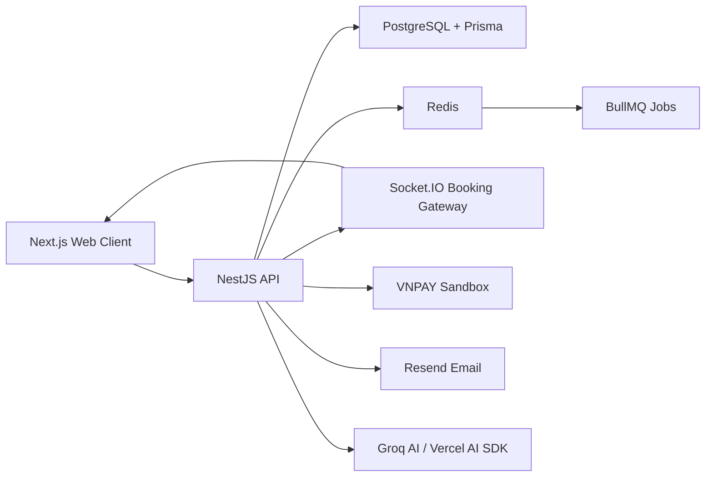

# Slide 03 - System Architecture

## Slide Title
Kiến trúc tổng thể hệ thống Railflow

## NotebookLM Instruction
Create a system architecture slide. Show the interaction between Web client, NestJS API, PostgreSQL, Redis/BullMQ, Socket.IO, external payment/email/AI providers.

## Main Slide Content
- Frontend sử dụng Next.js, React, TanStack Query, Zustand và Socket.IO client.
- Backend sử dụng NestJS theo module: Auth, Booking, Route, Trip, Train, Wallet, Payment, Chatbot, Mail, SeatIssues.
- PostgreSQL lưu dữ liệu nghiệp vụ chính qua Prisma.
- Redis dùng cho giữ ghế tạm thời, cache trạng thái và hàng đợi BullMQ.
- Socket.IO Gateway đẩy sự kiện thời gian thực: ghế bị giữ, ghế đã bán, trạng thái đơn, thống kê chuyến, sự cố ghế.
- Tích hợp ngoài: VNPAY sandbox, Resend email, Groq AI model.

## Speaker Notes
Giải thích kiến trúc theo dòng request: người dùng thao tác ở web, API xử lý nghiệp vụ, PostgreSQL đảm bảo dữ liệu bền vững, Redis xử lý trạng thái ngắn hạn, Socket.IO cập nhật UI realtime, dịch vụ ngoài xử lý thanh toán/email/AI.

## Diagram Suggestion
Use this structure:

## Source Evidence
- `api/src/app.module.ts`
- `api/package.json`
- `web/package.json`
- `api/src/modules/booking/booking.gateway.ts`
- `web/lib/store/socket.store.ts`

