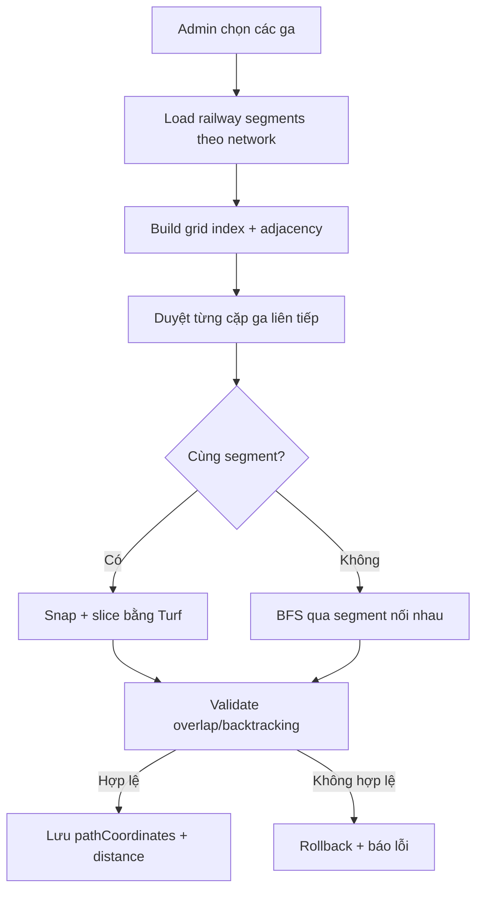

# Slide 06.1 - Route Creation Algorithm Overview

## Slide Title
Tạo tuyến đường bám theo đường ray thực tế

## NotebookLM Instruction
Create an overview slide for the route creation algorithm. Keep the explanation high level. Detailed internals will be presented in slide 06.2.

## Main Slide Content
- Admin chọn danh sách ga theo thứ tự trên bản đồ.
- Backend lấy các `RailwayLine` thuộc cùng `networkId`.
- Thuật toán kiểm tra từng cặp ga liên tiếp thay vì nối tất cả ga bằng đường thẳng.
- Nếu tìm được đường ray phù hợp, hệ thống lưu `pathCoordinates`, `totalDistanceKm`, `distanceFromStart`.
- Nếu tuyến hợp lệ, lưu `pathCoordinates`, `totalDistanceKm`, `distanceFromStart`; nếu lỗi, transaction rollback.
- Ý nghĩa: bảo đảm tuyến thương mại được tạo dựa trên hạ tầng đường ray đã import từ GeoJSON.

## Speaker Notes
Đây là điểm kỹ thuật quan trọng nhất của phân hệ hạ tầng. Thay vì nối ga bằng đường thẳng, hệ thống cố gắng bám theo đường ray vật lý trong GeoJSON. Slide này chỉ trình bày bức tranh tổng quan; slide sau đi sâu vào cơ chế snap, grid index và BFS.

## Diagram Suggestion

## Source Evidence
- `api/src/modules/route/utils/route-path-calculator.ts`
- `api/src/modules/route/route.service.ts`
- `web/features/routes/components/interactive-route-builder.tsx`

