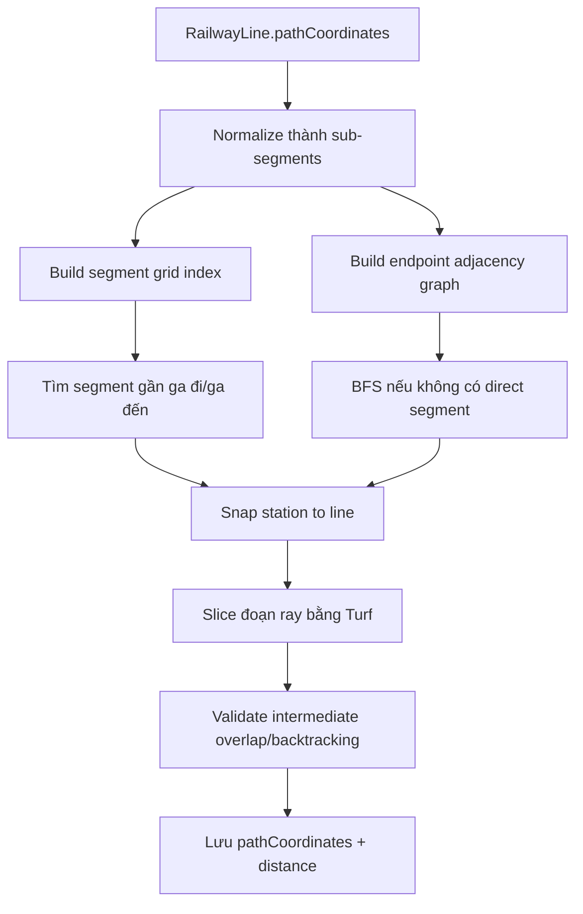

# Slide 06.2 - Route Path Algorithm Internals

## Slide Title
Cơ chế snap, grid index và BFS khi tính đường tuyến

## NotebookLM Instruction
Create a deeper technical slide for the route algorithm. This slide is allowed to be more detailed than the overview slide. Do not paste source code; explain the data structures and validation steps.

## Main Slide Content
- Chuẩn hóa dữ liệu đường ray:
  - `RailwayLine.pathCoordinates` có thể là LineString hoặc MultiLineString.
  - Backend tách thành các sub-segment để xử lý.
- Tối ưu tìm kiếm:
  - xây `SegmentGridIndex` để lọc nhanh các segment gần ga;
  - xây endpoint adjacency để biết các segment nào nối nhau.
- Tìm đường giữa hai ga:
  - ưu tiên `findDirectSegment` nếu hai ga có thể snap vào cùng một đoạn ray;
  - nếu không được, dùng `findConnectedSegment` với BFS tối đa số hop nhất định.
- Kiểm tra hợp lệ:
  - khoảng cách snap không vượt ngưỡng;
  - không đi xuyên qua ga trung gian chưa được chọn;
  - không quay ngược/chồng lên đoạn đã đi quá mức.
- Kết quả:
  - trả ra danh sách tọa độ đã cắt đúng đoạn ray;
  - tính km từng đoạn bằng Turf;
  - build khoảng cách tích lũy cho từng ga.

## Speaker Notes
Phần này có thể trình bày như một thuật toán xử lý đồ thị địa lý. RailwayLine là dữ liệu hình học; các endpoint của segment tạo thành graph; BFS tìm đường nối khi hai ga không nằm trên cùng một segment. Grid index giúp giảm số segment phải xét.

## Diagram Suggestion

## Source Evidence
- `api/src/modules/route/utils/route-path-calculator.ts`
- `api/src/modules/route/route.service.ts`

