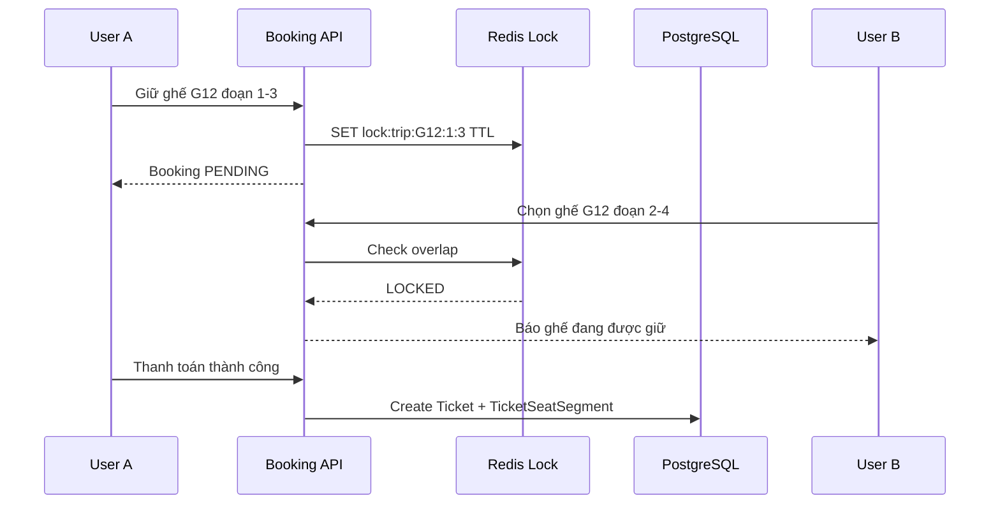

# Slide 08.1 - Seat Locking Problem

## Slide Title
Bài toán bán ghế theo chặng

## NotebookLM Instruction
Create the first slide of the seat-locking section. Focus on the railway-specific problem before explaining the technical solution.

## Main Slide Content
- Với tàu hỏa, một ghế không chỉ có trạng thái trống/đã bán cho toàn bộ chuyến.
- Cùng một ghế có thể bán cho nhiều hành khách nếu các chặng không giao nhau.
- Ví dụ:
  - Vé A đi ga 1 -> ga 3 chiếm segment 1 và 2.
  - Vé B đi ga 3 -> ga 5 có thể dùng cùng ghế vì bắt đầu sau khi A xuống.
  - Vé C đi ga 2 -> ga 4 không hợp lệ vì giao với A ở segment 2.
- Vì vậy hệ thống phải kiểm tra theo đoạn giữa các ga, không chỉ theo `seatId`.
- Railflow giải quyết bằng 2 lớp: Redis giữ tạm thời trước thanh toán và PostgreSQL chặn cuối sau thanh toán.

## Speaker Notes
Slide này nên giúp hội đồng hiểu vì sao bài toán đặt vé tàu phức tạp hơn đặt chỗ rạp phim. Ghế có thể tái sử dụng theo chặng, nên mô hình phải tách hành trình thành segment.

## Diagram Suggestion

## Source Evidence
- `api/src/modules/booking/booking.service.ts`
- `api/src/modules/booking/booking.gateway.ts`
- `api/prisma/schema.prisma`
- `web/lib/store/socket.store.ts`
- `web/features/booking/hooks/use-locked-seats.ts`

