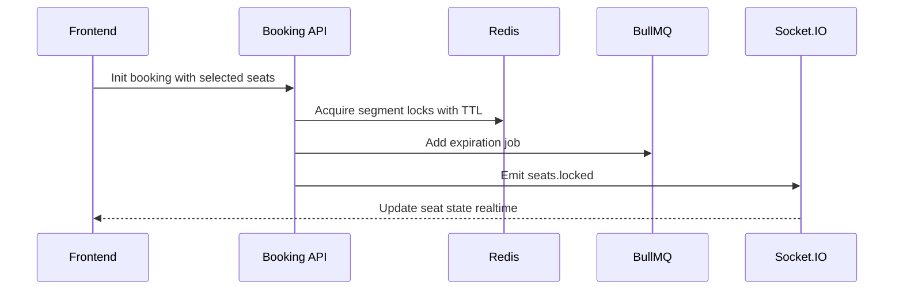

# Slide 08.2 - Redis Temporary Lock and Real-time UI

## Slide Title
Lớp giữ ghế tạm thời bằng Redis và Socket.IO

## NotebookLM Instruction
Explain the temporary locking layer in detail. Show why Redis is used before payment and how UI updates are synchronized.

## Main Slide Content
- Khi người dùng chọn ghế và tạo đơn chờ thanh toán, hệ thống chưa tạo vé chính thức.
- Backend tạo Redis lock theo từng đoạn:
  - `tripId`;
  - `seatId`;
  - `fromStationIndex`;
  - `toStationIndex`.
- Lock có TTL theo `BOOKING_LOCK_TIME_MINUTES`.
- Lua script trong Redis kiểm tra:
  - cùng ghế, cùng trip;
  - đoạn chặng có overlap hay không;
  - cùng `bookingCode` thì được gia hạn lock, không tự chặn chính đơn của mình.
- BullMQ tạo job hết hạn đơn để chuyển booking pending sang cancel và nhả ghế.
- Socket.IO phát sự kiện `seats.locked`, `seats.released`, `seats.booked`, `booking.status_update` để frontend cập nhật realtime.

## Speaker Notes
Redis phù hợp cho trạng thái ngắn hạn vì có TTL và tốc độ cao. Nếu người dùng giữ ghế nhưng không thanh toán, lock tự hết hạn và job xử lý đơn treo. Socket giúp người dùng khác thấy trạng thái ghế thay đổi mà không cần reload.

## Diagram Suggestion

## Source Evidence
- `api/src/modules/booking/booking.service.ts`
- `api/src/modules/booking/booking.gateway.ts`
- `api/src/modules/booking/booking.processor.ts`
- `web/lib/store/socket.store.ts`
- `web/app/(protected)/dashboard/booking/[tripId]/page.tsx`

