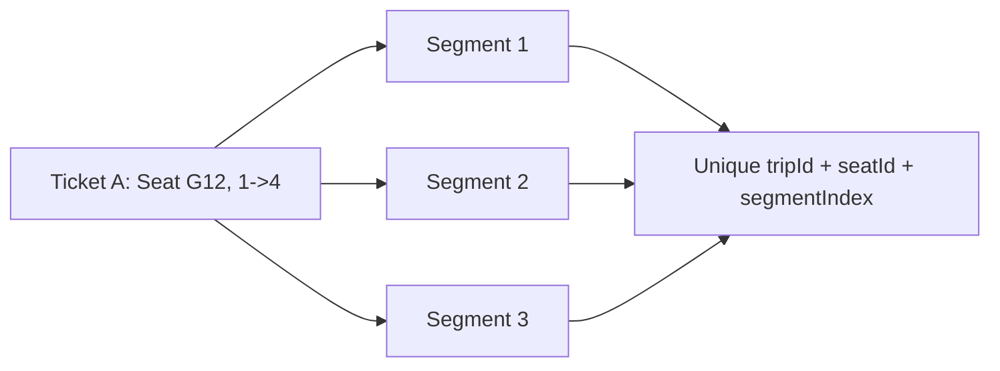

# Slide 08.3 - PostgreSQL Final Integrity with TicketSeatSegment

## Slide Title
Lớp chặn cuối bằng TicketSeatSegment trong PostgreSQL

## NotebookLM Instruction
Explain the durable database integrity layer after payment. Make it clear why Redis alone is not enough.

## Main Slide Content
- Redis chỉ bảo vệ giai đoạn giữ chỗ tạm thời; dữ liệu chính thức phải nằm trong PostgreSQL.
- Khi thanh toán thành công, `BookingService.confirmBooking`:
  - kiểm tra trip còn đặt được;
  - kiểm tra ghế chưa bị vé đã thanh toán khác chiếm;
  - tạo `Ticket`;
  - tách ticket thành nhiều `TicketSeatSegment`.
- Mỗi segment đại diện cho một đoạn giữa hai ga liên tiếp.
- Prisma schema đặt unique constraint:
  - `@@unique([tripId, seatId, segmentIndex])`.
- Nếu có race condition sau thanh toán, database vẫn từ chối insert trùng segment.
- Đây là bằng chứng quan trọng cho toàn vẹn dữ liệu đặt vé.

## Speaker Notes
Nên nói rõ đây là lớp phòng thủ cuối cùng. Trong hệ thống thật, không thể chỉ tin vào UI hoặc Redis. Database constraint mới là cơ chế đảm bảo cuối cùng khi có nhiều request đồng thời.

## Diagram Suggestion

## Source Evidence
- `api/prisma/schema.prisma`
- `api/src/modules/booking/booking.service.ts`
- `api/src/modules/seat-issues/seat-issues.service.ts`

