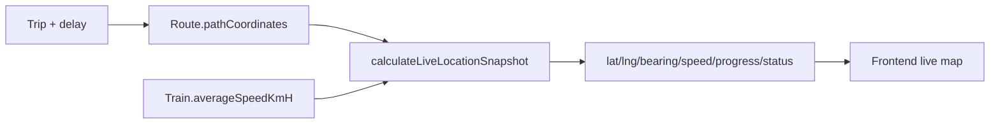

# Slide 10.1 - Real-time GPS Simulation Overview

## Slide Title
Theo dõi hành trình và GPS giả lập

## NotebookLM Instruction
Create an overview slide about live trip tracking. Detailed formula and delay handling are in slide 10.2.

## Main Slide Content
- Mỗi route lưu `pathCoordinates` bám theo đường ray thực tế.
- API `getLiveLocation` lấy trip, route, train và gọi `calculateLiveLocationSnapshot`.
- Hàm mô phỏng trả về latitude, longitude, bearing, speed, progress và status.
- Nếu chuyến đang chạy và mô phỏng tới cuối tuyến, hệ thống có thể tự chuyển sang `COMPLETED`.
- Frontend dùng dữ liệu này để hiển thị bản đồ theo dõi trực tuyến trong chi tiết chuyến.

## Speaker Notes
Nhấn mạnh delay được xử lý đúng: trễ khởi hành làm lùi thời điểm bắt đầu, trễ đến nơi làm kéo dài thời gian chạy. GPS không đo thật bằng thiết bị, nhưng mô phỏng theo dữ liệu tuyến đường thật và lịch trình.

## Diagram Suggestion

## Source Evidence
- `api/src/modules/trip/utils/live-location-calculator.ts`
- `api/src/modules/trip/trip.service.ts`
- `web/app/(protected)/dashboard/history/[code]/page.tsx`
- `web/app/(protected)/driver/trips/[id]/page.tsx`

