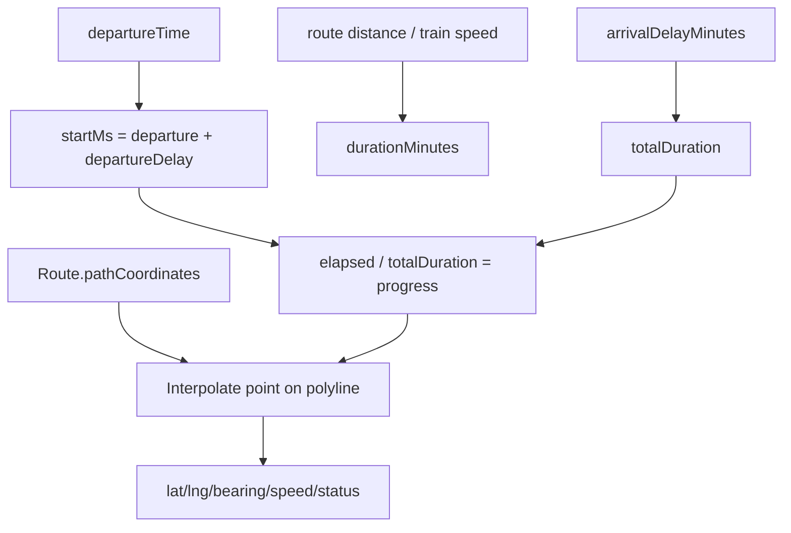

# Slide 10.2 - GPS Calculation and Delay Handling

## Slide Title
Cách tính vị trí, tốc độ và delay trong GPS giả lập

## NotebookLM Instruction
Create a deeper technical slide for the live GPS calculation. Explain how progress is calculated, how path interpolation works, and how delay affects the timeline.

## Main Slide Content
- Dữ liệu đầu vào:
  - `Trip.departureTime`;
  - `Trip.departureDelayMinutes`;
  - `Trip.arrivalDelayMinutes`;
  - `Route.pathCoordinates`;
  - `Route.totalDistanceKm`;
  - `Train.averageSpeedKmH`.
- Thời điểm bắt đầu thực tế:
  - `departureTime + departureDelayMinutes`.
- Tổng thời gian chạy:
  - nếu có `totalDistanceKm` và `averageSpeedKmH`, tính duration từ khoảng cách/tốc độ;
  - cộng thêm `arrivalDelayMinutes` để kéo dài thời gian tới nơi.
- Nội suy:
  - flatten các segment trong `pathCoordinates`;
  - tính khoảng cách tích lũy giữa các điểm;
  - xác định điểm trên polyline theo progress;
  - tính bearing từ điểm hiện tại sang điểm kế tiếp.
- Trạng thái:
  - trước giờ chạy: `SCHEDULED`;
  - đang chạy: `IN_PROGRESS`;
  - tới cuối tuyến: `COMPLETED`.

## Speaker Notes
Điểm cần nhấn mạnh là delay không ghi đè giờ gốc. Hệ thống giữ giờ gốc và cộng delay khi hiển thị/vận hành, giúp người dùng thấy cả giờ dự kiến ban đầu và ảnh hưởng của delay.

## Diagram Suggestion

## Source Evidence
- `api/src/modules/trip/utils/live-location-calculator.ts`
- `api/src/modules/trip/trip.service.ts`
- `api/src/modules/trip-delay-reports/trip-delay-reports.service.ts`

