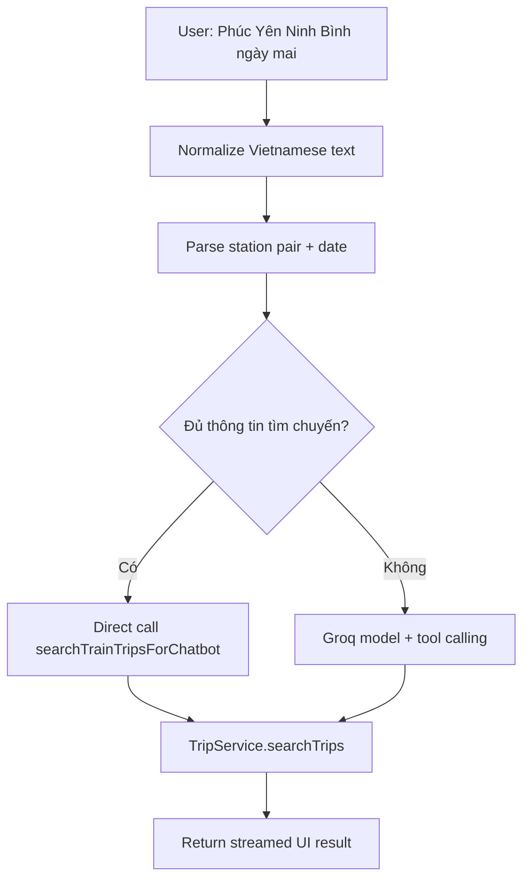

# Slide 12.2 - Chatbot Implementation Flow

## Slide Title
Luồng xử lý chatbot: từ câu hỏi tiếng Việt đến dữ liệu thật

## NotebookLM Instruction
Create a deeper technical slide for chatbot implementation. Explain direct search, station/date parsing, Groq streaming, and tool output.

## Main Slide Content
- Nhận message người dùng từ frontend chat.
- Chuẩn hóa tiếng Việt:
  - bỏ dấu;
  - đưa về chữ thường;
  - lọc ký tự đặc biệt;
  - so khớp tên ga không dấu/sai dấu.
- Nếu câu hỏi đủ ga đi, ga đến và ngày:
  - backend tự resolve station pair;
  - parse ngày như hôm nay, ngày mai, ngày kia, DD/MM;
  - gọi thẳng `searchTrainTripsForChatbot`.
- Nếu câu hỏi cần suy luận rộng hơn:
  - gửi vào Groq model qua Vercel AI SDK;
  - model được cấp tools và system prompt bắt buộc dùng tool khi hỏi dữ liệu hệ thống.
- Kết quả trả về frontend dưới dạng UI message stream, có thể render tool result như danh sách chuyến hoặc lịch sử đặt vé.

## Speaker Notes
Phần direct search giúp giảm rủi ro LLM trả lời sai lịch tàu. Khi câu hỏi rõ ràng, hệ thống dùng code nghiệp vụ để gọi dữ liệu thật trước, thay vì để model tự suy luận.

## Diagram Suggestion

## Source Evidence
- `api/src/modules/chatbot/chatbot.service.ts`
- `api/src/modules/chatbot/chatbot.tools.ts`
- `api/src/modules/chatbot/chatbot.prompt.ts`
- `web/features/chatbot/components/trip-search-result.tsx`

